<div align="center">


### Your doctor, just a tap away: find, book and pay for appointments online
**Browse specialists → pick a slot → pay with Razorpay → consult, with an AI health assistant on the side**

[](#-license)


**[🌐 Live App](https://docify-frontend-yw8c.onrender.com) · [📊 Admin & Doctor Panel](https://docify-admin.onrender.com) · [📦 Repository](https://github.com/Oliveya-15/Docify_MERN_Deployed)**

</div>

<br/>

> 💙 **Docify has three roles and one API.** Patients book and pay, doctors run their own schedule and earnings, and an admin onboards doctors and oversees every booking. **DocTalk**, a built-in AI assistant, helps patients find the right specialist without ever inventing a doctor. Details in [DocTalk AI Assistant](#-doctalk-ai-assistant).

<br/>

## 📑 Table of Contents

- [✨ What Docify Does](#-what-docify-does)
- [📸 Screenshots](#-screenshots)
- [🤖 DocTalk AI Assistant](#-doctalk-ai-assistant)
- [📅 Booking & Slot Management](#-booking--slot-management)
- [💳 Payments with Razorpay](#-payments-with-razorpay)
- [🛠️ Admin Panel & Doctor Panel](#-admin-panel--doctor-panel)
- [🔐 Authentication & Security](#-authentication--security)
- [🧱 Architecture & Workflow](#-architecture--workflow)
- [🧰 Tech Stack](#-tech-stack)
- [🌍 Deployment](#-deployment)
- [🔗 Live Demo](#-live-demo)
- [⚡ Getting Started](#-getting-started)
- [🔧 Environment Variables](#-environment-variables)
- [🔌 API Overview](#-api-overview)
- [📁 Project Structure](#-project-structure)
- [🧪 Honest Limitations](#-honest-limitations)
- [🧭 Roadmap](#-roadmap)
- [📄 License](#-license)
- [🙏 Acknowledgments](#-acknowledgments)

<br/>

---

## ✨ What Docify Does

<p align="center">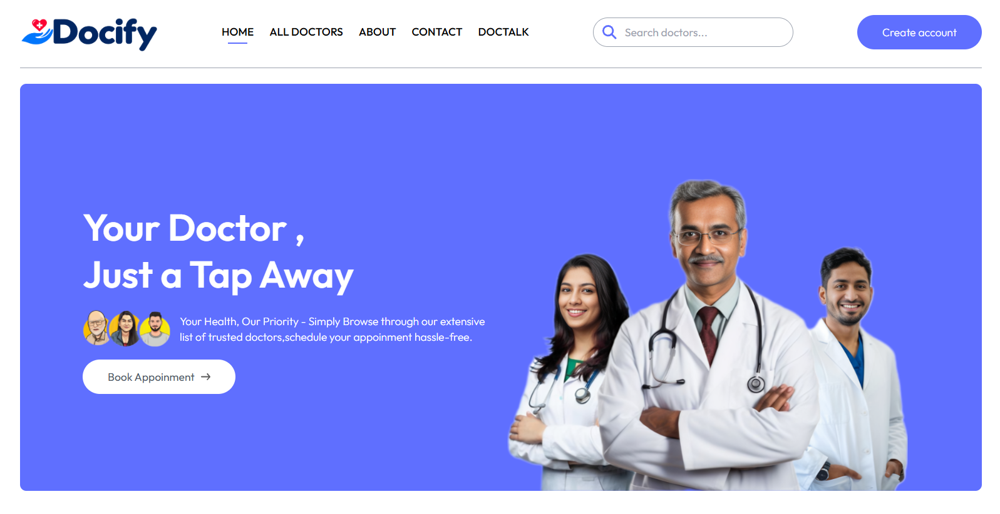</p>
<p align="center"><sub><strong>Home</strong>: hero, find-by-speciality shortcuts, top doctors and a sign-up banner</sub></p>

- 🔎 **Find a doctor:** browse every doctor, filter by one of six specialities (General physician, Gynecologist, Dermatologist, Pediatricians, Neurologist, Gastroenterologist), or search by name, speciality, degree, experience, bio or address.
- 🩺 **Doctor profiles:** photo, degree, years of experience, an about section, address, consultation fee and a live **Available / Not Available** indicator.
- 📅 **Smart slot booking:** the next seven days of half-hour slots, 10:00 to 21:00. Slots already taken disappear from the picker, and the server re-checks every booking before saving it.
- 💳 **Pay online:** pay a booked appointment through the Razorpay checkout. The server confirms the payment with Razorpay before marking it as paid.
- 🗂️ **My Appointments:** every booking with doctor, address, date and time, and a clear state: *Pay Online*, *Paid*, *Completed* or *Cancelled*. Cancelling releases the slot.
- 🤖 **DocTalk:** an AI health assistant with a **General Health** mode and an empathetic **Mental Wellness** mode. It recommends only doctors that really exist in the database and shows them as tappable cards.
- 👤 **Patient profile:** name, phone, address, gender, date of birth and a profile photo uploaded to Cloudinary.
- 🧑‍⚕️ **Doctor panel:** each doctor logs in to see earnings, patients, appointments, mark visits completed or cancelled, and edit fees, address and availability.
- 🛠️ **Admin panel:** add doctors with a photo, toggle availability, see platform-wide stats and cancel any appointment.
- 📱 **Responsive:** the patient app and panels work on phones, with a slide-in mobile menu and a mobile search bar.

<br/>

---

## 📸 Screenshots

### 🧑‍🤝‍🧑 Patient App

<table>
<tr>
<td width="50%">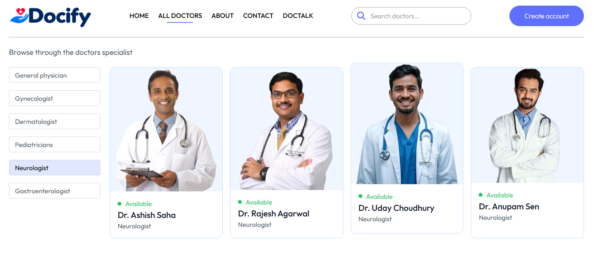<p align="center"><sub><strong>All Doctors</strong>: speciality filter and availability badges</sub></p></td>
<td width="50%">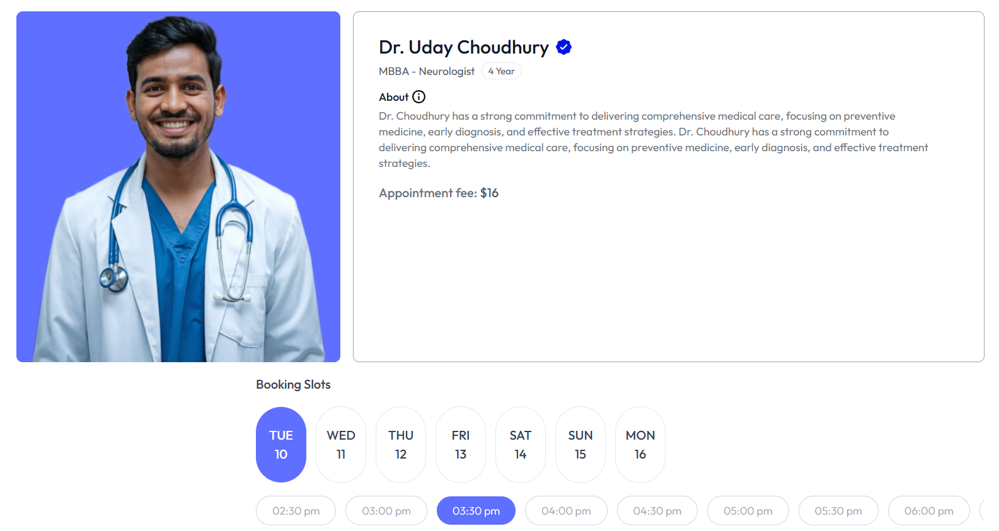<p align="center"><sub><strong>Booking</strong>: doctor profile, fee and the 7-day slot picker</sub></p></td>
</tr>
<tr>
<td width="50%">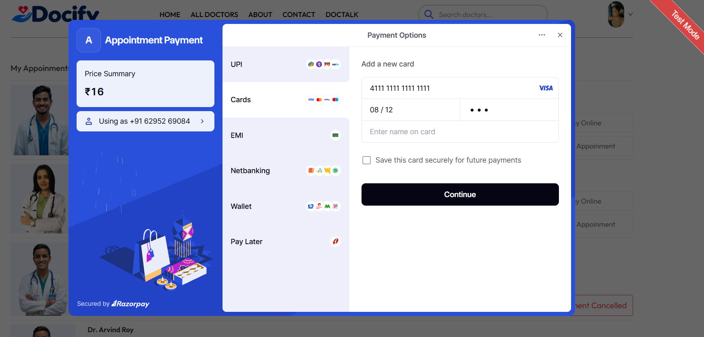<p align="center"><sub><strong>Payment</strong>: Razorpay checkout for a booked appointment</sub></p></td>
<td width="50%">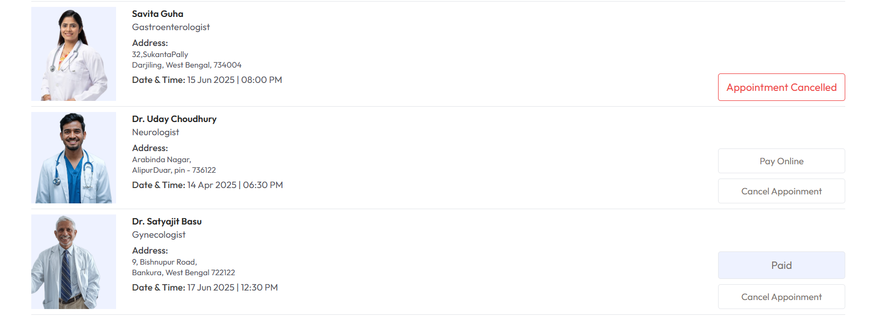<p align="center"><sub><strong>My Appointments</strong>: pay, cancel and track every booking</sub></p></td>
</tr>
</table>

<p align="center">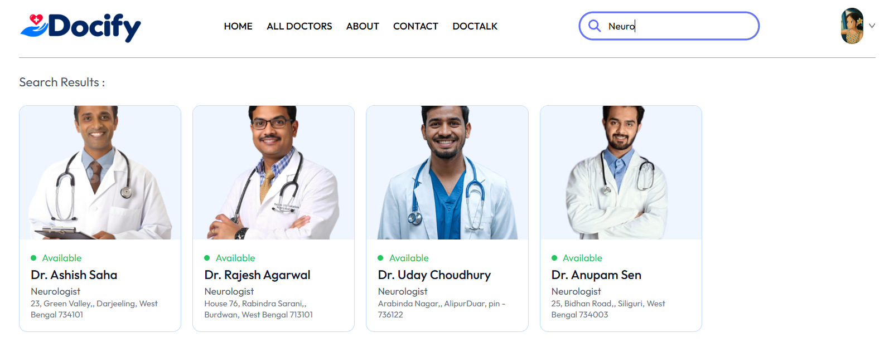</p>
<p align="center"><sub><strong>Search</strong>: find doctors by name, speciality, degree, experience or location</sub></p>

### 🤖 DocTalk

<table>
<tr>
<td width="50%">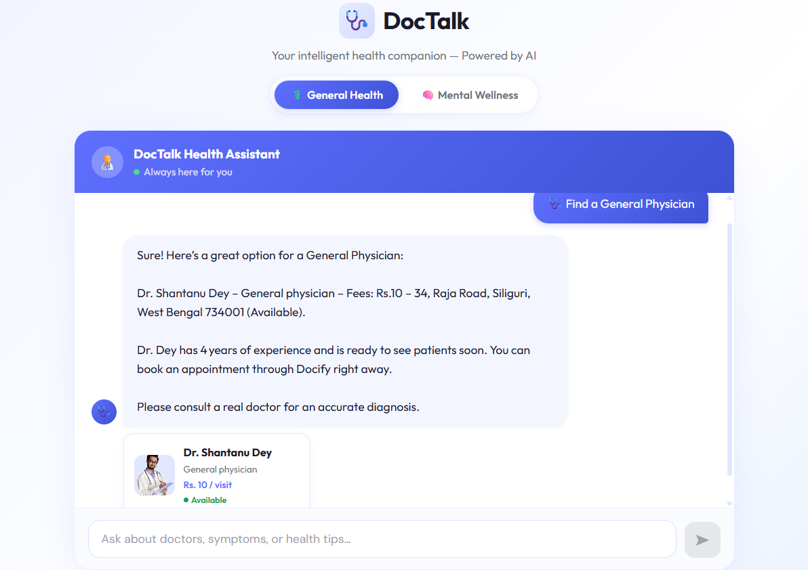<p align="center"><sub><strong>General Health</strong>: symptom questions and doctor recommendations as cards</sub></p></td>
<td width="50%">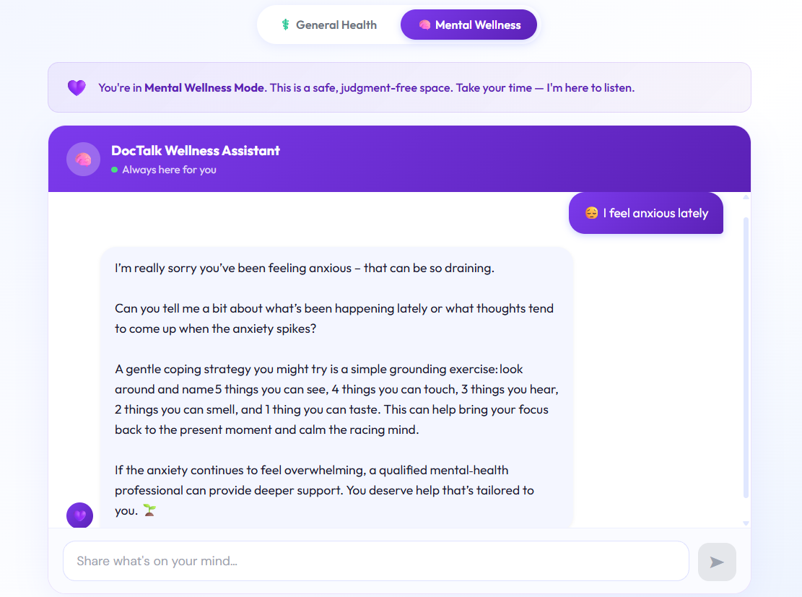<p align="center"><sub><strong>Mental Wellness</strong>: a calm, empathy-first conversation</sub></p></td>
</tr>
</table>

### 🛠️ Admin Panel & Doctor Panel

<p align="center">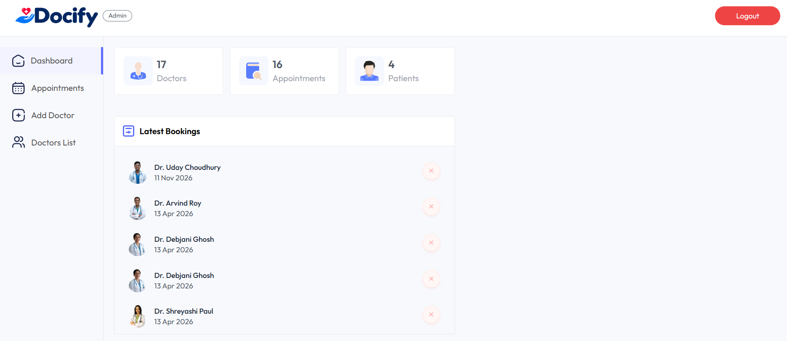</p>
<p align="center"><sub><strong>Dashboard</strong>: total doctors, appointments, patients and the latest bookings</sub></p>

<table>
<tr>
<td width="50%">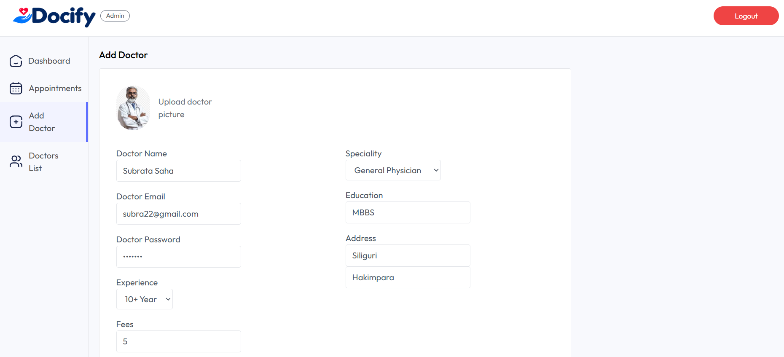<p align="center"><sub><strong>Add Doctor</strong>: photo upload, credentials, fees and address</sub></p></td>
<td width="50%">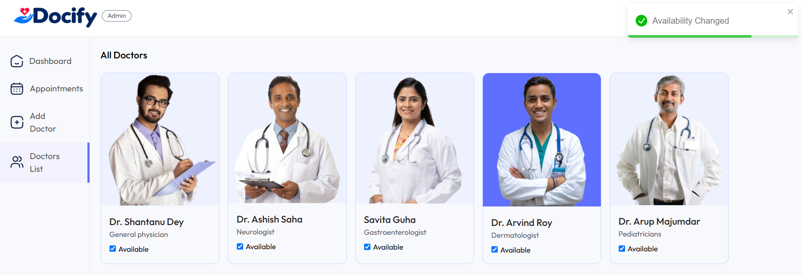<p align="center"><sub><strong>Doctors List</strong>: toggle availability with one click</sub></p></td>
</tr>
<tr>
<td width="50%" colspan="2">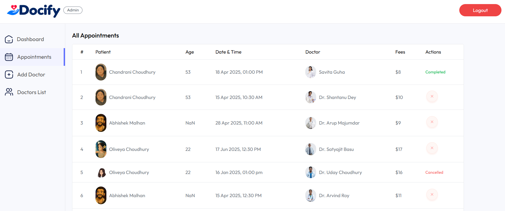<p align="center"><sub><strong>Doctor Appointments</strong>: payment mode, fees, complete or cancel</sub></p></td>
</tr>
</table>

### 📱 Mobile

<table align="center">
<tr>
<td align="center" width="50%"><p><sub><strong>Mobile (1/2)</strong>: home page</sub></p></td>
<td align="center" width="50%">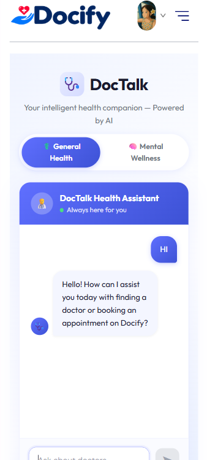<p><sub><strong>Mobile (2/2)</strong>: DocTalk chat</sub></p></td>
</tr>
</table>

<br/>

---

## 🤖 DocTalk AI Assistant

<p align="center">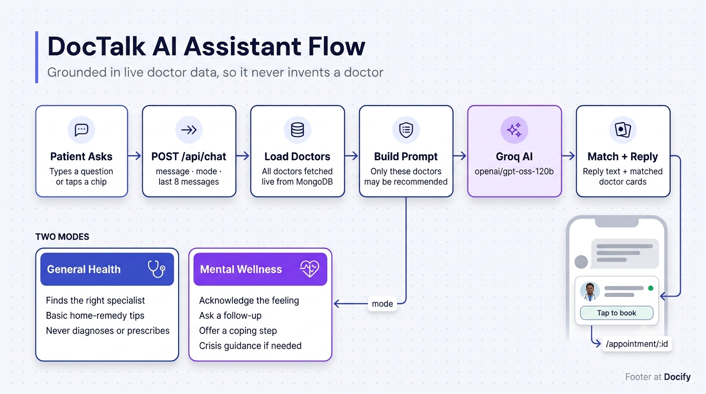</p>

**DocTalk** is a chat assistant that helps patients work out *which* doctor to see. Its main design goal is simple: **never recommend a doctor who isn't on Docify.**

| Step | What happens |
|---|---|
| 1. **Ask** | A signed-in patient types a question or taps a quick-start chip, for example *Find a General Physician* or *I feel anxious lately*. |
| 2. **Ground** | The backend loads **every doctor live from MongoDB** (name, speciality, degree, experience, fees, address, availability) and numbers them into the system prompt. |
| 3. **Constrain** | The prompt orders the model to use only that list, to copy names, fees and locations exactly, and to say so when nothing matches. |
| 4. **Answer** | The request goes to the **Groq API** (`openai/gpt-oss-120b`) with the last eight messages for context. Markdown symbols are stripped so the reply reads cleanly. |
| 5. **Match** | The server checks which real doctors the reply mentions, by full name or name without "Dr.", and returns them next to the text. |
| 6. **Book** | The chat shows each match as a card with photo, speciality, fee and availability. Tapping it opens that doctor's booking page. |

| Mode | Behaviour |
|---|---|
| ⚕️ **General Health** | Friendly and concise (3 to 5 sentences). Suggests specialists and basic home remedies for mild symptoms. It never diagnoses serious illness or prescribes medication, and every symptom answer ends with a reminder to consult a real doctor. Temperature `0.5`. |
| 🧠 **Mental Wellness** | Acknowledges the feeling first, asks a follow-up question, then offers a coping strategy. If self-harm is mentioned it responds with support and an Indian crisis helpline. Temperature `0.7`, with a violet theme so the mood change is visible. |

Switching mode clears the conversation. If the doctor database can't be read, DocTalk says so instead of guessing, and if the search page finds nobody it offers a **Chat with DOCTALK** button.

> ⚠️ DocTalk is an assistant, not a medical professional. It is built to point people to real doctors, not to replace them.

<br/>

---

## 📅 Booking & Slot Management

<p align="center">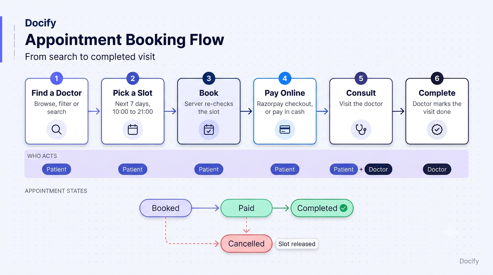</p>

| Rule | Details |
|---|---|
| **Slot window** | Seven days starting today, half-hour slots from **10:00 to 21:00**. Today's list starts from roughly the next hour. |
| **Slot storage** | Each doctor stores a `slots_booked` map keyed by date (`D_M_YYYY`) with the booked times as values. The picker hides anything already in it. |
| **Server-side check** | When a booking arrives, the API confirms the doctor is available and the slot is still free before saving. A taken slot returns *Slot not available*. |
| **Snapshots** | An appointment stores a copy of the patient and doctor details at booking time, so history stays readable even if a profile changes later. |
| **Login to book** | Browsing is open to everyone. Booking asks guests to log in first. |
| **Cancellation** | Patients can cancel their own appointments, and the admin can cancel any. Both release the slot straight away. Ownership is checked, so a patient can't cancel someone else's booking. |
| **Completion** | A doctor marks a visit completed from their own panel, and only for appointments assigned to them. |

**Appointment states:** `Booked` → `Paid` → `Completed`, or `Cancelled` at any point before completion. The record keeps three flags (`payment`, `isCompleted`, `cancelled`) and every screen derives its label from them.

<br/>

---

## 💳 Payments with Razorpay

<p align="center">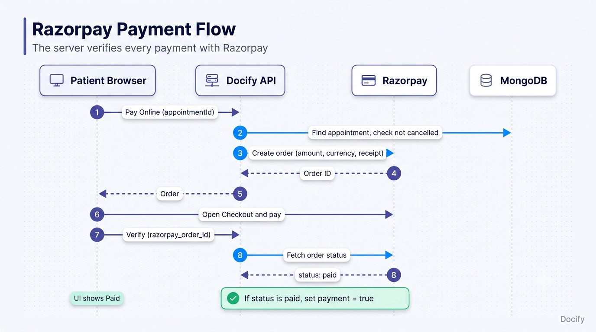</p>

1. On **My Appointments**, a patient taps **Pay Online** for an unpaid, uncancelled booking.
2. The API creates a **Razorpay order** for the appointment fee (amount in the smallest currency unit, currency from `CURRENCY`) with the appointment ID as the receipt.
3. The browser opens the **Razorpay Checkout** with the public key.
4. After payment, the browser sends the order ID to the API.
5. The server **fetches the order from Razorpay itself** and only if its status is `paid` does it mark the appointment as paid. The browser's word alone is never trusted.
6. The patient sees **Paid**, and the doctor's panel shows the appointment as *Online*. Unpaid appointments show as *Cash*.

| Detail | How it works |
|---|---|
| **Keys** | `RAZORPAY_KEY_ID` and `RAZORPAY_KEY_SECRET` stay on the server. Only the public key id is exposed to the frontend through `VITE_RAZORPAY_KEY_ID`. |
| **Test mode** | Use Razorpay test keys while developing. Test card details are in the [Razorpay docs](https://razorpay.com/docs/payments/payments/test-card-details/). |
| **Doctor earnings** | A doctor's dashboard counts an appointment's fee once it is **paid or completed**. |

<br/>

---

## 🛠️ Admin Panel & Doctor Panel

Both roles share **one admin app** with a role-aware login. The login card switches between *Admin* and *Doctor*, and the sidebar, routes and navbar badge change to match whoever signed in.

### 🛠️ Admin

| Module | What the admin can do |
|---|---|
| **Dashboard** | Totals for doctors, appointments and patients, plus the five latest bookings with a quick cancel action. |
| **Appointments** | A full table with patient (photo and age), date and time, doctor, fee and status. Cancel any upcoming appointment. |
| **Add Doctor** | Create a doctor with photo, name, email, password, speciality, degree, experience, about, fees and two-line address. The photo goes to Cloudinary and the password is hashed. |
| **Doctors List** | Every doctor as a card with a one-click **Available** toggle that updates the patient app instantly. |

### 🧑‍⚕️ Doctor

| Module | What the doctor can do |
|---|---|
| **Dashboard** | Earnings, appointment count, unique patient count and latest bookings with **complete** and **cancel** actions. |
| **Appointments** | Patient, payment mode (*Online* or *Cash*), age, date and time, and fees. Mark each visit completed or cancelled. |
| **Profile** | See the public profile and edit **fees, address and availability**. |

<br/>

---

## 🔐 Authentication & Security

| Area | Implementation |
|---|---|
| **Passwords** | Hashed with **bcrypt** (10 salt rounds). Password hashes are excluded from profile, list and dashboard responses, and the public doctor list also hides email addresses. |
| **Validation** | Email format is checked with `validator`, and passwords must be at least 8 characters. |
| **Three roles, three tokens** | Patients send `token`, doctors send `dtoken` and the admin sends `atoken`. Each has its own middleware (`authUser`, `authDoctor`, `authAdmin`), so a patient token can never open a doctor or admin route. |
| **Sessions** | Signed **JWT** verified with `JWT_SECRET`. Patient and doctor tokens carry the user ID, and the browser keeps each in `localStorage`. |
| **Admin account** | Credentials live in environment variables, not in the database, and the admin login has its own endpoint and token. |
| **Ownership checks** | Patients can cancel only their own appointments. Doctors can complete or cancel only appointments assigned to them. |
| **Server-verified payments** | Payment status is confirmed directly with Razorpay before an appointment is marked paid. |
| **CORS** | An allow-list limited to the local dev origin and the deployed patient and admin apps, with the custom `token`, `atoken` and `dtoken` headers permitted. |
| **Uploads** | Profile and doctor photos are sent to Cloudinary and stored as permanent URLs. |
| **AI safety** | DocTalk is grounded in live doctor data, forbidden from diagnosing or prescribing, and has a dedicated crisis response in Mental Wellness mode. |

<br/>

---

## 🧱 Architecture & Workflow

<p align="center">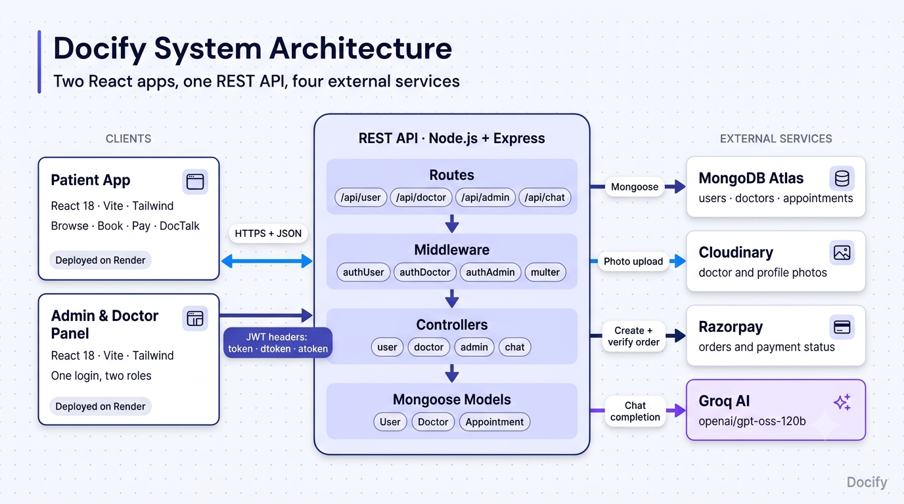</p>

Docify is **two React apps and one REST API**: a patient app and a combined admin and doctor panel, both talking to a Node and Express backend over HTTPS with JWT. MongoDB Atlas holds the data, Cloudinary holds every photo, Razorpay handles payments and Groq powers DocTalk.

| Layer | Responsibility |
|---|---|
| `routes/` | Express routers for `/api/user`, `/api/doctor`, `/api/admin` and `/api/chat`, attaching auth and upload middleware per route |
| `controllers/` | Business logic: user, doctor, admin and chat controllers |
| `models/` | Mongoose schemas for users, doctors and appointments |
| `middlewares/` | `authUser`, `authDoctor`, `authAdmin` and Multer file handling |
| `config/` | MongoDB and Cloudinary setup |
| `frontend/src/` | Pages, shared components and an `AppContext` that holds the doctor list, token and profile |
| `admin/src/` | Separate `AdminContext`, `DoctorContext` and `AppContext` providers with role-based routes |

### 🗄️ Data Model

<p align="center">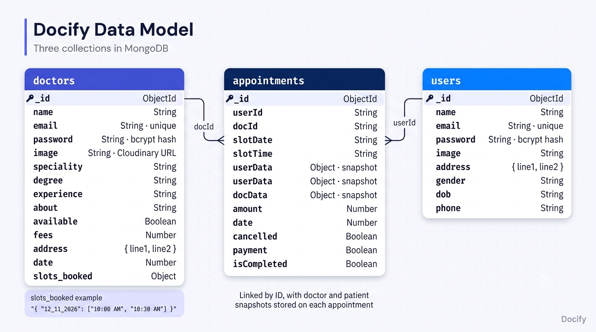</p>

Three collections cover the whole product. Appointments link to users and doctors by ID and keep snapshots of both, and each doctor carries the `slots_booked` map that powers conflict-free booking.

**Design principles:**

- **One source of truth for doctors.** The patient app, the admin panel and DocTalk all read the same doctor collection, so a change by the admin shows up everywhere at once.
- **The server decides.** Slot availability, payment status and ownership are all re-checked on the backend, never trusted from the browser.
- **Grounded AI.** DocTalk's answers are built from live database rows, which is what keeps it from hallucinating doctors.
- **Images never live on the server.** Every photo streams to Cloudinary and comes back as a permanent URL.

<br/>

---

## 🧰 Tech Stack

<table>
<tr><th>Layer</th><th>Technology</th></tr>
<tr><td>Patient app</td><td>React 18 · Vite 5 · React Router 6 · Tailwind CSS 3 · axios · React Toastify · Font Awesome · React Icons · Fuse.js</td></tr>
<tr><td>Admin &amp; Doctor panel</td><td>React 18 · Vite 6 · React Router 7 · Tailwind CSS 3 · axios · React Toastify</td></tr>
<tr><td>Backend</td><td>Node.js 18+ (ES modules) · Express 4 · Mongoose 8</td></tr>
<tr><td>Database</td><td>MongoDB Atlas</td></tr>
<tr><td>Auth &amp; Security</td><td>JWT · bcrypt · validator · CORS allow-list</td></tr>
<tr><td>Payments</td><td>Razorpay (orders API and Checkout)</td></tr>
<tr><td>AI</td><td>Groq API · <code>openai/gpt-oss-120b</code></td></tr>
<tr><td>Images</td><td>Cloudinary · Multer</td></tr>
<tr><td>Deployment</td><td>Render (API, patient app and admin panel) · MongoDB Atlas · Cloudinary</td></tr>
</table>

<br/>

---

## 🌍 Deployment

| Part | Host | Notes |
|---|---|---|
| Patient app | **Render** | Root directory `frontend`, build `npm install && npm run build`, publish `dist`, env `VITE_BACKEND_URL` and `VITE_RAZORPAY_KEY_ID` |
| Admin & Doctor panel | **Render** | Root directory `admin`, same build settings, env `VITE_BACKEND_URL` |
| API | **Render** (web service) | Root directory `backend`, build `npm install`, start `npm start`, plus the backend env vars |
| Database | **MongoDB Atlas** | Allow network access from anywhere, because Render's outbound IPs change |
| Images | **Cloudinary** | Permanent storage that survives redeploys |

**Key decisions:**

- **IPv4 for Atlas.** `config/mongodb.js` connects with `family: 4`, which fixes `ECONNREFUSED` errors on networks where the IPv6 route fails.
- **CORS allow-list.** `server.js` lists the exact origins allowed to call the API. When you deploy under new URLs, add them there or the browser will block every request.
- **Razorpay script.** The Checkout script is loaded in the patient app's `index.html`, so payments work on any page.
- **SPA routing.** Both React apps use client-side routing, so add a rewrite from `/*` to `/index.html` on the static hosts, or refreshing a deep link like `/doctors` returns a 404.

> ⏳ If the API runs on a free tier, the first request after a period of inactivity can take up to a minute while the service wakes up. That is infrastructure, not a bug.

<br/>

---

## 🔗 Live Demo

| | |
|---|---|
| 🌐 **Patient app** | [docify-frontend-yw8c.onrender.com](https://docify-frontend-yw8c.onrender.com) |
| 📊 **Admin & Doctor panel** | [docify-admin.onrender.com](https://docify-admin.onrender.com) |
| ⚙️ **API** | [https://docify-backend-3yzh.onrender.com] (https://docify-backend-3yzh.onrender.com) |
| 📦 **Source** | [github.com/Oliveya-15/Docify_MERN_Deployed](https://github.com/Oliveya-15/Docify_MERN_Deployed) |

> 🔑 Create a free account on the sign-up page to explore the patient app and book a visit. The admin and doctor panel is for staff only.
> ⚠️ Payments run through Razorpay, so use test mode and test cards unless you really mean to pay.

<br/>

---

## ⚡ Getting Started

**Requirements:** Node.js 18+ and a MongoDB database (a free [MongoDB Atlas](https://www.mongodb.com/cloud/atlas/register) cluster works well). You also need a free [Cloudinary](https://cloudinary.com) account for photos, a [Razorpay](https://razorpay.com) account (test mode is fine) for payments and a [Groq](https://console.groq.com) API key for DocTalk.

### 1. Clone

```bash
git clone [https://github.com/Oliveya-15/Docify_MERN_Deployed.git](https://github.com/Oliveya-15/Docify_MERN_Deployed.git)
cd Docify_MERN_Deployed